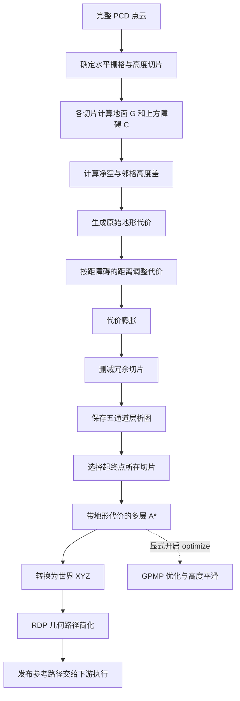

# 项目 PCT 方案完整学习指南

> 整理日期：2026-11-02。
> 本文保存自本次对话中的完整讲解，依据项目中现有 `pct_planner` 的实际源码，从构图一直讲到路径输出，最后对照当前在线层析图，说明哪些机制被保留、哪些已经调整。
> 本轮研究只读代码，没有修改项目或启动仿真。对话中的交互式膨胀示例在本文中保留为链接。

先记住整体流程：



**当前默认启用的是多层 A* 和 RDP 简化，GPMP 关闭。**这由[规划配置](/home/likai/legbot_3D_Nav/src/pct_planner/planner/config/param.py:1)和[规划分支](/home/likai/legbot_3D_Nav/src/pct_planner/planner/scripts/planner_wrapper.py:260)共同决定。

---

# 一、PCT 层析图到底表达了什么？

## 1.1 先从二维高度图理解

普通二维高度图可以理解成：

> 每个水平格 $(x,y)$，保存一个地面高度。

例如：

```text
水平位置       地面高度
(1.0, 2.0)      0.00 m
(1.1, 2.0)      0.02 m
(1.2, 2.0)      0.04 m
```

这样可以表达坡道。

但同一个水平位置可能同时存在：

- 一楼地面；
- 二楼地面；
- 楼板底面；
- 屋顶。

因此，一个高度值不够表达多层建筑。

## 1.2 PCT 在同一水平位置保存多份高度关系

PCT 引入多个高度切片。每个切片、每个水平格，主要保存：

| 符号 | 含义 |
|---|---|
| $H_k$ | 第 $k$ 个切片的高度阈值 |
| $G_k(x,y)$ | 该阈值下方最高的点 |
| $C_k(x,y)$ | 该阈值上方最低的点 |
| $I_k=C_k-G_k$ | 这两个表面之间的竖直净空 |
| $T_k(x,y)$ | 该位置的通行代价 |

这里有一个核心区别：

**切片阈值 $H_k$ 用来划分点；真实地面高度保存在 $G_k$ 中。**

假设切片阈值是 1.5 米，下面的地面完全可以是 0.02 米，代码保存的 $G$ 就是 0.02 米，不会强行变成 1.5 米。

因此：

> `slice_dh=0.5` 表示相邻切片阈值间隔 0.5 米，并不表示地面高度只能取 0、0.5、1.0……这些值。

---

# 二、项目当前使用哪些参数？

项目有多个场景配置。当前构图默认使用 **Go2 配置**，它继承 Building 配置，再覆盖部分参数。

不能直接把 `SceneTrav` 基类默认值，或者 `SceneBuilding` 的值，当成最终 Go2 参数。

| 参数 | Go2 配置 | 含义 |
|---|---:|---|
| `resolution` | 0.10 m | 每个水平格的边长 |
| `ground_h` | 0.0 m | 初始高度范围的基准 |
| `slice_dh` | 0.50 m | 切片阈值间隔 |
| `kernel_size` | 7 | 地形邻域窗口为 7×7 格 |
| `interval_min` | 0.50 m | 最低允许净空 |
| `interval_free` | 0.55 m | 希望获得的净空 |
| `slope_max` | 0.40 rad | 用来生成平缓地形判定阈值 |
| `step_max` | 0.16 m | 台阶分支允许的单轴高度差阈值 |
| `standable_ratio` | 0.5 | 邻域内平缓格比例参数 |
| `cost_barrier` | 50 | 构图阶段的障碍代价 |
| `safe_margin` | 0.50 m | 膨胀权重衰减范围的参数 |
| `inflation` | 0.20 m | 膨胀权重保持为 1 的距离参数 |

来源：[Building 参数](/home/likai/legbot_3D_Nav/src/pct_planner/tomography/config/scene_building.py:9)、[Go2 覆盖参数](/home/likai/legbot_3D_Nav/src/pct_planner/tomography/config/scene_go2.py:1)。

有三个名字需要提前分开：

- **最低净空 0.50 米**：用于判断上下表面之间是否容得下机器人。
- **切片间隔 0.50 米**：用于生成多个高度阈值。
- **输出路径加高 0.50 米**：用于把地面路径转换为基座参考路径。

它们现在数值相同，但用途不同。

---

# 三、从完整点云构建 G、C 层析图

## 3.1 根据点云范围确定地图大小

原有构图程序读取完整 PCD 后，先计算点云包围盒。

水平格数量为：

$$
N_x=\left\lceil\frac{x_{\max}-x_{\min}}{r}\right\rceil+4
$$

$$
N_y=\left\lceil\frac{y_{\max}-y_{\min}}{r}\right\rceil+4
$$

其中 $r$ 为水平分辨率。

地图中心：

$$
c_x=\frac{x_{\max}+x_{\min}}2,\qquad
c_y=\frac{y_{\max}+y_{\min}}2
$$

初始切片数量：

$$
N_s=\left\lceil
\frac{z_{\max}-\text{ground\_h}}{\Delta h}
\right\rceil
$$

第一个切片阈值：

$$
H_0=\text{ground\_h}+\Delta h
$$

所以默认阈值为：

```text
0.5 m、1.0 m、1.5 m、2.0 m……
```

这是原有离线构图方式：**根据整张点云确定地图中心和范围。**

源码：[地图范围初始化](/home/likai/legbot_3D_Nav/src/pct_planner/tomography/scripts/tomography.py:66)。

## 3.2 一个点如何进入水平格？

大致计算为：

$$
i_x=\operatorname{round}\left(\frac{x-c_x}{r}\right)+\left\lfloor\frac{N_x}{2}\right\rfloor
$$

$$
i_y=\operatorname{round}\left(\frac{y-c_y}{r}\right)+\left\lfloor\frac{N_y}{2}\right\rfloor
$$

点落在哪个水平格，由其 XY 决定。

需要注意，构图数组实际轴顺序是：

```text
[切片编号, X方向格索引, Y方向格索引]
```

源码里还有 `row`、`column`、`x`、`y` 等不同命名，阅读时要跟踪转换，不能单看变量名推断方向。

## 3.3 每个点会参与多个切片

对每一个点 $p=(x,y,z)$，代码遍历所有切片。

对于某个阈值 $H_k$：

- 若 $z\le H_k$，用它更新该格的地面最大值；
- 若 $z>H_k$，用它更新该格的上方最小值。

公式为：

$$
G_k(i,j)=\max\{z_p\mid p\text{落入该格},\ z_p\le H_k\}
$$

$$
C_k(i,j)=\min\{z_p\mid p\text{落入该格},\ z_p>H_k\}
$$

因此，一个点可以参与许多切片。

GPU 中使用原子最大值、最小值，解决多个点同时更新同一格的问题。

源码：[G/C 构图核](/home/likai/legbot_3D_Nav/src/pct_planner/tomography/scripts/kernels.py:99)。

## 3.4 用一个竖直柱理解

假设某个 XY 柱中有这些点：

```text
z=6.0 m：更高处表面
z=3.0 m：二楼地面
z=2.8 m：二楼楼板底面
z=0.0 m：一楼地面
```

对应关系：

| 切片阈值 $H$ | $G$ | $C$ | 净空 $C-G$ |
|---:|---:|---:|---:|
| 0.5 | 0.0 | 2.8 | 2.8 |
| 1.0 | 0.0 | 2.8 | 2.8 |
| 2.5 | 0.0 | 2.8 | 2.8 |
| 2.9 | 2.8 | 3.0 | 0.2 |
| 3.5 | 3.0 | 6.0 | 3.0 |

可以看到：

1. 多个切片可能重复表达一楼空间。
2. 阈值落在楼板厚度中时，净空很小。
3. 更高的切片可以表达二楼空间。

这就是后面需要“切片简化”的原因之一。

## 3.5 G 只是候选表面高度

原有构图没有先做：

- 地面语义识别；
- 法向估计；
- 足端支撑分析；
- 平面拟合验证。

它先依据高度极值形成 $G$，再通过邻格高度差、净空和代价，判断这个表面是否适合通行。

因此，柱顶、台阶顶、桌面等也可能暂时出现在某些切片的 $G$ 中。

---

# 四、净空怎样影响地形代价？

定义：

$$
I=C-G
$$

它表示候选地面与上方最近表面之间的竖直距离。

## 4.1 低于最低净空：直接障碍

当：

$$
I<0.50
$$

代码令：

$$
T_0=50
$$

这里是严格小于，所以净空恰好 0.50 米时，不会在这一分支直接设为障碍。

## 4.2 最低净空到期望净空之间：增加代价

净空惩罚为：

$$
P_I=\max(0,\ 20(0.55-I))
$$

例如：

| 净空 | 净空惩罚 |
|---:|---:|
| 0.49 m | 直接设障碍代价 50 |
| 0.50 m | 1.0 |
| 0.525 m | 0.5 |
| 0.55 m | 0 |
| 1.00 m | 0 |

因此：

- `interval_min` 是硬性下界；
- `interval_free` 是不再加净空惩罚的高度。

**期望净空 0.55 米不是说净空低于它就完全不能走。**

但有一个观测语义问题：原代码没有找到上方点时，把 $C$ 初始化为很大的数，所以会表现成“大净空”。它没有独立证明这段上方空间已经被充分观测。

---

# 五、梯度怎样计算？它和坡度是什么关系？

这部分容易被变量名称误导。

## 5.1 原代码先计算邻格高度差

对一个格：

$$
D_x=
\max\left(
(G_{i,j}-G_{i-1,j})^2,\ 
(G_{i,j}-G_{i+1,j})^2
\right)
$$

$$
D_y=
\max\left(
(G_{i,j}-G_{i,j-1})^2,\ 
(G_{i,j}-G_{i,j+1})^2
\right)
$$

然后形成两个量：

$$
q=D_x+D_y
$$

$$
q_{\max}=\max(D_x,D_y)
$$

含义：

- 每个方向取两侧更大的高度变化；
- $q$ 综合 X、Y 两个方向；
- $q_{\max}$ 关注变化更大的单个方向。

**这里没有除以分辨率，也没有开平方，单位实际为平方米。**

因此，不能把 `grad_mag_sq` 直接读成“坡度角”。

源码：[高度差计算](/home/likai/legbot_3D_Nav/src/pct_planner/tomography/scripts/tomogram.py:131)。

## 5.2 平缓地形阈值从坡度参数转换而来

代码计算：

$$
h_s=1.2r\tan(\theta_{\max})
$$

Go2 配置：

$$
r=0.1,\qquad \theta_{\max}=0.4
$$

得到：

$$
h_s\approx0.050735\text{ m}
$$

$$
h_s^2\approx0.002574
$$

当：

$$
q\le h_s^2
$$

就进入平缓地形分支。

对于理想平面：

$$
G(x,y)=ax+by
$$

有：

$$
q=r^2(a^2+b^2)
$$

所以这个判定与坡度大小相关。

不过由于有 **1.2 倍系数**，它并不是严格在 0.4 弧度处分界。并且超出平缓阈值后，代码还会尝试台阶分支。

## 5.3 平缓区域的代价

平缓分支：

$$
T_0=P_I+15\frac{q}{h_s^2}
$$

例如只在 X 方向相邻高度差为 0.02 米，Y 方向没有变化：

$$
q=0.02^2=0.0004
$$

地形部分代价约为：

$$
15\times\frac{0.0004}{0.002574}\approx2.33
$$

如果净空是 0.525 米，再加净空惩罚 0.5：

$$
T_0\approx2.83
$$

所以平缓区域内部也存在不同代价，A* 会更偏好更平的路线。

---

# 六、台阶怎样判断？

## 6.1 超出平缓阈值后，尝试台阶分支

当：

$$
q>h_s^2
$$

代码继续检查：

$$
q_{\max}\le h_c^2
$$

其中：

$$
h_c=\text{step\_max}=0.16\text{ m}
$$

这表示两个坐标方向中，各自更大的高度差，没有超过台阶阈值。

注意这里使用的是 $q_{\max}$，所以它检查的是单轴最大变化，而不是把 XY 两个方向的高度差合成后再限制在 0.16 米以内。

## 6.2 还要看周围有没有足够的平缓格

程序在当前格周围检查 **7×7** 邻域。

统计满足：

$$
q<h_s^2
$$

的邻格数量，记为 $n_{\rm flat}$。

阈值：

$$
n_{\rm stand}
=\operatorname{int}(0.5\times7\times7)-1
=23
$$

至少达到 23 个，才接受这个台阶候选。

可以直观理解为：

> 当前格虽然有明显高度变化，但周围要存在足够多的平缓区域，不能整片地形都很破碎。

不过，这个“平缓格计数”只检查高度差，没有同时验证每个被计数格的净空和观测有效性。

## 6.3 台阶分支代价

通过后：

$$
T_0=P_I+20\frac{q_{\max}}{h_c^2}
$$

例如单轴台阶高 0.12 米：

$$
20\times\frac{0.12^2}{0.16^2}=11.25
$$

再加净空惩罚。

如果高度差超过阈值，或者周围平缓格数量不足：

$$
T_0=50
$$

## 6.4 原始地形代价的完整分段

可以概括成：

$$
T_0=
\begin{cases}
50,& I<I_{\min}\\[3pt]
P_I+15q/h_s^2,& q\le h_s^2\\[3pt]
P_I+20q_{\max}/h_c^2,
& q>h_s^2,\ q_{\max}\le h_c^2,\ n_{\rm flat}\ge23\\[3pt]
50,& \text{其他}
\end{cases}
$$

这里第二、第三分支都以净空满足最低要求为前提。

源码：[完整通行代价计算](/home/likai/legbot_3D_Nav/src/pct_planner/tomography/scripts/kernels.py:133)。

---

# 七、项目新增的“按距离调整代价”实际做了什么？

这是当前项目版本中很值得仔细看的部分。

调用顺序是：

```text
原始地形代价 T₀
    ↓
计算到障碍格的距离
    ↓
调整地形代价 T₁
    ↓
膨胀得到最终代价 T
```

## 7.1 距离怎么找？

程序在有限的正方形邻域内，寻找：

$$
T_0\ge50-0.001
$$

的格子。

找到最近障碍后：

$$
d=\sqrt{\Delta i^2+\Delta j^2}
$$

这个 $d$ 的单位是**格数**。

它是在有限窗口中搜索，不是整张地图的全局距离场。窗口内没有障碍时，距离设成一个大值。

## 7.2 实际公式是“衰减已有代价”

定义：

$$
D=\frac{1.5\,\text{safe\_margin}}r
$$

默认：

$$
D=\frac{1.5\times0.5}{0.1}=7.5\text{ 格}
$$

对非障碍格：

$$
T_1=\max\left(0.001,\ T_0\left(1-\frac dD\right)\right)
$$

障碍格保持原值。

例如原代价 $T_0=10$：

| 距障碍 | 调整后的代价 |
|---:|---:|
| 2 格 | $10(1-2/7.5)\approx7.33$ |
| 6 格 | $10(1-6/7.5)=2.00$ |
| 很远 | 截断为 0.001 |

因此，虽然注释写的是“提高代价”，**实际实现会随障碍距离增大而降低已有地形代价**。

它带来的倾向是：

- 靠近障碍，保留较多原始地形代价；
- 远离障碍，地形代价可能被压得很低；
- 原本代价为 0 的平地，经过这里通常变为 0.001。

真正把障碍的高代价传播到周围，是下一步膨胀。

源码：[距离搜索与调整核](/home/likai/legbot_3D_Nav/src/pct_planner/tomography/scripts/kernels.py:229)。

---

# 八、膨胀的完整原理

## 8.1 膨胀传播的是代价

假设某个障碍格代价为 50。

如果周围格代价仍很低，机器人中心可能贴着障碍走。因此，程序把障碍的影响传播到附近格子。

同时，它也会传播坡地、台阶等其他非零地形代价。

## 8.2 距离权重

设：

- $d_m$：两个格中心的实际距离，单位米；
- $\rho=\text{inflation}$；
- $m=\text{safe\_margin}$；
- $r=\text{resolution}$。

权重：

$$
w(d_m)=
\operatorname{clip}
\left(
1-\frac{d_m-\rho}{m+r},
0,1
\right)
$$

含义：

1. 距离不超过 $\rho$，权重为 1。
2. 超过 $\rho$ 后，权重线性降低。
3. 理论上到 $\rho+m+r$ 时降为 0。
4. 实际计算还受有限窗口限制。

虽然附近注释提到“指数权重”，当前公式是**截断线性权重**。

## 8.3 多个邻格如何合并？

最终代价：

$$
T(p)=\max_{q\in\mathcal N(p)}
\left[T_1(q)\,w(\|p-q\|)\right]
$$

也就是：

> 计算每个邻格对当前位置的贡献，然后取最大值。

它不是把多个障碍贡献累加，也不是普通求和卷积。

两个障碍分别贡献 30 和 35，最终取 35，不会变成 65。

源码：[权重生成](/home/likai/legbot_3D_Nav/src/pct_planner/tomography/scripts/tomogram.py:67)、[最大值膨胀核](/home/likai/legbot_3D_Nav/src/pct_planner/tomography/scripts/kernels.py:201)。

## 8.4 为什么 `inflation=0.2`，实际可能要离得更远？

因为后面 A* 的普通通行阈值是 **20**。

障碍代价 50 的衰减贡献，只要仍然超过 20，普通情况下就不能通过。

在默认参数下，理论边界可由下式求得：

$$
50\left(1-\frac{d_m-0.2}{0.5+0.1}\right)=20
$$

得到：

$$
d_m=0.56\text{ m}
$$

所以：

**`inflation=0.2` 表示权重为 1 的范围；最终普通通行边界还受到安全余量和 A* 阈值共同影响。**

下面是单个代价 50 障碍的示例，暂不考虑后面介绍的 gateway 特例：

[打开交互式 PCT 膨胀示例](/home/likai/.codex/visualizations/2026/11/02/01a19c33-0a66-7c30-981f-8d2b1a7bce2d/pct-inflation.html)。该链接指向对话中生成的原始示例文件。

## 8.5 有限窗口也会影响膨胀形状

窗口半宽：

```python
int((safe_margin + inflation) / resolution)
```

当前 Go2 参数在 Python 浮点运算下，结果实际截断成 6，因此窗口为：

```text
13×13 格
```

轴方向最多检查到 0.6 米。

这意味着实际效果既受距离权重影响，也受正方形窗口截断影响；不能只用一个理想圆形半径描述全部行为。

---

# 九、原有 PCT 怎样处理未知区域？

原有 PCT 主要面向完整点云，没有我们现在独立维护的观测状态体系。

## 9.1 构图时的缺失值

初始化：

```text
G = -1,000,000：没有下方点
C = +1,000,000：没有上方点
```

输出时才把缺失值转成 NaN。

这会产生两种不同现象。

### 已知与未知接壤处

真实地面高度接近 0，相邻未知格却是 $-10^6$。

高度差极大，容易形成障碍代价 50，再向外膨胀。

### 一片完全未知区域的内部

相邻格全都是 $-10^6$：

```text
相邻高度差 = 0
净空 = 很大的正数
```

所以原始代价可能是 0，经过距离调整后变为 0.001。

因此：

**原有 PCT 没有统一将所有未知格显式设成障碍。已知/未知边缘出现高代价，是高度差计算带来的间接效果。**

加载阶段还会将 NaN 地面替换为 -100。这个特殊高度也不能替代完整的观测与机体安全判定。

这正是我们现在在线图要单独记录未知、避免缺失高度参与梯度计算、再对未知范围做机体空间检查的原因。

---

# 十、层析图如何简化？

这里简化的是**切片数量**。

## 10.1 为什么很多切片重复？

在前面的两层楼示例中，0.5、1.0、1.5 米等阈值，可能都得到：

```text
G=一楼地面
C=二楼楼板底面
```

它们表达的通行空间相似。

保留所有重复切片，会增加：

- 地图存储；
- 搜索节点；
- 后续查询和优化开销。

## 10.2 代码怎样判断中间层值得保留？

设：

- $l$：最近保留的下层；
- $m$：当前检查层；
- $m+1$：下一原始层。

检查是否存在某个水平格满足：

$$
\left[
(G_m>G_l)\ \lor\ (T_l>T_m)
\right]
\land
(G_{m+1}>G_m)
\land
(T_m<50)
$$

可以拆成：

1. 当前层提供了更高的地面，或者更低的代价；
2. 再往上一层还会出现更高地面；
3. 当前格的代价没有达到构图障碍值 50。

只要**有一个格满足**，就保留整张当前切片。

它没有对每个 XY 柱分别保存不同的精简层集合。

源码：[切片删减](/home/likai/legbot_3D_Nav/src/pct_planner/tomography/scripts/tomogram.py:188)。

## 10.3 当前代码的实际边界

循环条件是：

```python
while m_idx < n_slice_init - 2:
```

结束后追加 `m_idx`。

所以初始层数不少于 3 时，固定追加的是倒数第二层，而不是最后一层。

另外，文件没有保存原始保留索引 `idx_simp`。因此：

> 精简后的“第 3 层”，不能直接解释成原始切片阈值 $H_0+3\Delta h$。

读取实际表面高度，应以 G 通道为准。

## 10.4 RViz 显示还有额外去重

`publishTomogram()` 会在显示副本上隐藏部分重复表面，并传播较小代价。

这属于显示处理，不会回写到保存的规划数据中。

因此，要区分：

- 构图时的切片删减；
- 显示时的重复点隐藏；
- 规划后的路径点简化。

它们发生在不同阶段。

---

# 十一、最终保存的层析图是什么格式？

文件包含：

```text
data
resolution
center
slice_h0
slice_dh
```

其中：

```text
data.shape = [5, 保留切片数, X格数, Y格数]
```

五个通道：

| 通道 | 保存内容 |
|---|---|
| 0 | 膨胀后的通行代价 $T$ |
| 1 | 代价在 X 方向的两格差 |
| 2 | 代价在 Y 方向的两格差 |
| 3 | 地面高度 $G$ |
| 4 | 上方表面高度 $C$ |

这里又出现一种“梯度”：

$$
T_x(i,j)=T(i+1,j)-T(i-1,j)
$$

$$
T_y(i,j)=T(i,j+1)-T(i,j-1)
$$

它用于表示**代价变化方向**，与前面用于地形判定的高度差平方不同。

而且当前实现没有除以 $2r$，严格说保存的是两格代价差。

文件写盘时转为 `float16`，读取时再升为 `float32`。升回 float32 不会恢复写盘时损失的精度。

源码：[五通道导出](/home/likai/legbot_3D_Nav/src/pct_planner/tomography/scripts/tomography.py:125)。

项目现有 `building2_9.pickle` 的实值为：

```text
data.shape = (5, 11, 189, 184)
resolution = 0.1
```

但它是预计算文件，不能仅凭当前配置，断言它当初用了完全相同的构图参数。

另一个启动细节：

- 当前构图默认导出 `building2_9_go2.pickle`；
- 当前规划默认读取 `building2_9.pickle`。

这两个名字没有自动绑定。

---

# 十二、起终点怎样接入层析图？

## 12.1 先选择起终点对应的切片

对输入位置 $(x,y,z)$，包装器遍历各切片，查询对应地面高度。

先保留：

$$
|G_k(x,y)-z|\le\text{slice\_dh}
$$

的切片，再从中选择通行代价较小的一层。

**实际选择标准是候选层中的最小代价，并非最小高度误差。**

同一个地面可能被多个切片重复表达，选代价较小的切片，能够避开某些切片边界产生的高代价。

源码：[起终点选层](/home/likai/legbot_3D_Nav/src/pct_planner/planner/scripts/planner_wrapper.py:122)。

## 12.2 高度查询用了最近邻

查询地面时，代码使用整层有效高度样本的最近邻插值。

它没有给“最近有效高度离查询位置有多远”设置上限。

因此，原包装器可能在目标格没有真实地面样本时，从远处借到一个地面高度。

这是完整地图假设下相对宽松的接入方式，与我们现在显式检查 `no_ground_sample` 的方式不同。

## 12.3 起点和终点检查并不完全对称

原有 A* 会检查起终点索引范围，并显式拒绝代价过高的目标节点。

但它没有以同样方式先拒绝高代价起点。

因此，不能把原有 A* 理解成已经包含我们现在统一的：

```text
实际位置安全
+ 起点节点安全
+ 实际位置到节点的连接安全
```

这套准入接口。

---

# 十三、PCT 多层 A* 怎样搜索？

## 13.1 搜索节点保存两种“高度身份”

每个节点保存：

```text
layer：属于哪张切片
height：该格的真实地面高度
cost：通行代价
ele：gateway 标记
```

还有内部索引：

$$
q=
\left(
\operatorname{int}(G/r),\ i,\ j
\right)
$$

其中第一个分量是**地面高度栅格**，不是 `layer`。

这样，两个切片虽然编号不同，但如果表达同一个地面，可以拥有相同的物理高度索引。

源码：[节点初始化](/home/likai/legbot_3D_Nav/src/pct_planner/planner/lib/src/a_star/a_star_search.cc:23)。

## 13.2 水平方向使用八邻域

实际邻域为：

```text
↖ ↑ ↗
←   →
↙ ↓ ↘
```

不是三维体素的 26 邻域，也没有单独的“原地向上移动一层”邻居。

## 13.3 每次展开前，先决定使用哪张切片

当前节点取出后，代码先在相同 XY 位置扫描其他切片。

候选切片必须满足：

$$
|G_{k'}-G_k|\le0.2\text{ m}
$$

$$
0<T_{k'}\le20
$$

再选择代价严格更低的一层。

选好后，从这张切片展开周围八个格。

可以理解为：

> 沿真实地面高度连续的表面移动，并在不同切片对同一地面的表达之间切换。

因此，切片切换本身不意味着机器人突然从一楼跳到二楼。

真正上楼，需要沿楼梯或坡道连续推进，地面高度逐渐增加。

源码：[实际切片切换规则](/home/likai/legbot_3D_Nav/src/pct_planner/planner/lib/src/a_star/a_star_search.cc:247)。

## 13.4 gateway 标记的实际作用

Python 会根据相邻切片的代价差和地面高度差，生成 `+2`、`-2` 标记。

但当前 C++ 的 `DecideLayer()` 没有依靠 gateway 决定换层，而是直接扫描切片。

gateway 实际参与的是高代价格的豁免：

- 普通目的格代价超过 20，通常拒绝；
- 如果该格有 gateway 标记；
- 且与当前地面的高差不超过 0.3 米；
- 则可能继续允许进入。

所以，**“代价超过 20 一定不能走”存在 gateway 例外。**

## 13.5 边代价怎么算？

$$
c(u,v)=\|q_v-q_u\|_2+wT(v)
$$

当前包装器传入：

$$
w=1
$$

然后：

$$
g(v)=g(u)+c(u,v)
$$

$$
f(v)=g(v)+h(v)
$$

例如：

- 平地横走一格，目的格代价 5：

$$
c=1+5=6
$$

- 平地对角走一格，目的格代价 5：

$$
c=\sqrt2+5
$$

- 横走一格，同时地面高度增加一个高度格，目的格代价 5：

$$
c=\sqrt2+5
$$

这里几何距离采用栅格单位，没有再乘分辨率；地形代价也是每进入一格加一次。

所以分辨率变化后，路径评分不能简单认为保持相同的物理尺度。

源码：[邻居准入与边代价](/home/likai/legbot_3D_Nav/src/pct_planner/planner/lib/src/a_star/a_star_search.cc:170)。

## 13.6 为什么可能宁愿绕远？

假设两条路线：

```text
路线 A：10 步，每步地形代价约 8
路线 B：14 步，每步地形代价约 0.2
```

粗略比较：

$$
J_A\approx10+10\times8=90
$$

$$
J_B\approx14+14\times0.2=16.8
$$

即使 B 更长，总代价仍明显更小。

这就是地形代价和膨胀能够让路线主动远离高代价区域的机制。

## 13.7 默认启发式

当前默认使用三维 diagonal distance。

将三个索引方向的绝对差排序为：

$$
d_{\min}\le d_{\rm mid}\le d_{\max}
$$

启发值：

$$
h=
\sqrt3d_{\min}
+\sqrt2(d_{\rm mid}-d_{\min})
+(d_{\max}-d_{\rm mid})
$$

它主要引导搜索靠近目标；地形代价主要进入累计代价 $g$。

这里应把它理解成**项目当前的多层启发式搜索实现**。切片先选一个较低代价层、节点身份合并等处理，与教科书里固定邻接图的标准 A* 有区别。

---

# 十四、路径如何转换和简化？

## 14.1 从栅格变回真实坐标

默认分支根据 A* 节点所在切片和格索引，计算：

$$
x=(i-\lfloor N_x/2\rfloor)r+c_x
$$

$$
y=(j-\lfloor N_y/2\rfloor)r+c_y
$$

$$
z=G_k(i,j)+0.5
$$

因此输出的是原 PCT 约定的**基座参考路径**，不是足端地面轨迹。

源码：[路径坐标转换](/home/likai/legbot_3D_Nav/src/pct_planner/planner/scripts/planner_wrapper.py:218)。

## 14.2 RDP 简化原理

默认容差：

```text
route_simplify_epsilon = 0.08 m
```

步骤：

1. 连接首尾点 A、B。
2. 计算所有中间点到三维线段 AB 的距离。
3. 找最大偏离点。
4. 最大距离不超过 0.08 米，就删除所有中间点。
5. 超过时，在最大偏离点处分割，两段分别递归处理。

例如：

```text
A=(0, 0, 0.5)
M=(0.5, 0.05, 0.5)
B=(1, 0, 0.5)
```

M 距 AB 为 0.05 米，会被删除。

如果：

```text
M=(0.5, 0, 0.59)
```

高度偏离 0.09 米，会被保留。

所以它会同时考虑平面转弯和高度变化。

## 14.3 RDP 的 0.08 米表示什么？

它表示：

> 简化折线对原路径的几何近似误差。

它不表示：

- 障碍安全余量；
- 机体半径；
- 新直线段已经通过碰撞检查；
- 动力学上可执行。

原包装器的 RDP 没有重新检查简化线段上的障碍和代价。

源码：[三维 RDP](/home/likai/legbot_3D_Nav/src/pct_planner/planner/scripts/planner_wrapper.py:194)。

当前在线层析普通规划和脱困 A* 同样直接输出原包装器的 RDP 结果，
不追加简化线段的障碍、代价检查，也不恢复密集 A* 路径。

---

# 十五、GPMP 优化是什么？当前是否执行？

## 15.1 当前默认不执行

当前默认：

```python
optimize_path = False
```

所以目前通常使用：

```text
A* → XYZ → RDP → 下游执行
```

源码注释说明，GPMP 扩展与当前 Jazzy 依赖组合存在 ABI 问题。这是仓库记录，本轮没有重新运行该故障。

下面介绍的是代码中保留的可选优化分支。

## 15.2 GPMP 从 A* 路径出发

它把 A* 路径当作初始解，再优化支持点及其中间状态。

有两种模型：

| 模型 | 每点状态 |
|---|---|
| WNOA | $X,\dot X,Y,\dot Y$ |
| WNOJ | $X,\dot X,\ddot X,Y,\dot Y,\ddot Y$ |

当前 `use_quintic=True` 对应 WNOJ 分支。

WNOJ 可以理解成：

> 同时描述位置、速度、加速度，并鼓励相邻状态以平滑方式衔接。

## 15.3 优化目标包含哪些项？

大致为：

$$
J=
J_{\rm start}
+J_{\rm goal}
+J_{\rm smooth}
+J_{\rm terrain}
+J_{\rm heading}
$$

分别对应：

- 起点状态；
- 终点状态；
- 相邻状态平滑；
- 高代价区域惩罚；
- 过大的转向角速度惩罚。

源码：[GPMP 因子图构造](/home/likai/legbot_3D_Nav/src/pct_planner/planner/lib/src/trajectory_optimization/gpmp_optimizer/gpmp_optimizer.cc:97)。

### 平滑项

每个坐标轴采用类似匀加速度传播：

$$
\begin{bmatrix}
X_{i+1}\\
\dot X_{i+1}\\
\ddot X_{i+1}
\end{bmatrix}
\approx
\begin{bmatrix}
1&t&t^2/2\\
0&1&t\\
0&0&1
\end{bmatrix}
\begin{bmatrix}
X_i\\
\dot X_i\\
\ddot X_i
\end{bmatrix}
$$

GP 先验允许偏离该传播，但会对偏离施加代价。

### 地形障碍项

它查询的是通行代价图，并不是直接使用到障碍物的三维距离。

当前残差：

$$
r_T=[\max(T-15,0)]^2
$$

优化框架还会对残差做平方，所以相关目标项实际呈四次增长趋势。

这里的 **15 是代价阈值，不是安全距离**。

源码：[障碍残差](/home/likai/legbot_3D_Nav/src/pct_planner/planner/lib/src/trajectory_optimization/gpmp_optimizer/factors/gp_obstacle_factor.cc:3)。

### 转向角速度项

根据速度、加速度计算：

$$
\omega=
\frac{\dot X\ddot Y-\dot Y\ddot X}
{\dot X^2+\dot Y^2+10^{-6}}
$$

超过配置阈值时增加惩罚。

## 15.4 为什么插值点有用？

当前默认大致：

- 每约 10 个 A* 点取一个支持点；
- 每两个支持点之间安排 8 个 GP 插值检查点。

插值状态由两端支持状态计算，不必把每个中间点都设置为独立优化变量。

这样既能控制变量数量，也能在段内检查高代价和转向变化。

当前求解器使用 GTSAM 的 Levenberg–Marquardt，最多 100 次迭代。

## 15.5 高度 z 另外处理

WNOJ 的六维状态中没有 z。

XY 优化完成后，程序：

1. 根据最终 XY 和切片重新查地面高度；
2. 添加内部参考高度；
3. 运行独立的一维五次样条高度平滑；
4. 再转换输出坐标。

高度平滑使用 OSQP，包含高度拟合、三阶导数惩罚及连续性约束。

还有一个当前实现细节：WNOJ 内部默认参考高度为 0.1 米，最终转换又加 0.5 米，和默认不优化分支的高度约定并不完全一致。由于默认关闭，不能把这个分支当作已经验证的当前执行主链。

---

# 十六、几个必须区分的安全概念

## 16.1 地形代价低，表达的是该地图规则下的通行偏好

它依据：

- 上下表面间隙；
- 邻格高度变化；
- 周围平缓格数量；
- 膨胀后的代价。

原有实现没有完整保存：

- 独立空闲射线证据；
- 每个支撑区域的置信度；
- 完整三维机体姿态；
- 每一步足端接触位置；
- 连续运动过程中所有机体体积的碰撞结果。

## 16.2 八邻域检查和连续走廊检查有区别

当前原 A* 主要检查目的邻格。

对角移动时，没有单独核对两个侧邻格，也没有对整段连续机体扫掠体积逐点验证。

膨胀能减少贴障，但不能直接等价成我们现在设计的完整机体走廊检查。

## 16.3 三个代价值容易混淆

| 数值 | 所在阶段 | 用途 |
|---:|---|---|
| 50 | 构图 | 障碍代价 |
| 20 | A* | 普通通行阈值 |
| 15 | GPMP | 开始增加优化障碍残差的阈值 |

因此：

- 构图代价 30 虽然没有达到 50，普通 A* 仍可能拒绝；
- A* 允许的代价 18，在开启 GPMP 时仍会受到优化惩罚；
- gateway 还可能给予某些高代价格豁免。

---

# 十七、它与我们当前在线层析图有哪些区别？

这部分与之前机器人停住的问题直接相关。

| 方面 | 项目原有 PCT | 我们当前在线实现 |
|---|---|---|
| 输入 | 一次完整 PCD | 实时注册点云帧 |
| 世界栅格锚点 | 完整点云包围盒中心 | 固定世界原点 |
| 历史存储 | 本次处理的完整点云 | 稀疏高度桶 Welford 统计与固定大小分块 |
| G/C 更新 | 每次遍历点云生成 | 新点驱动；静态成熟冻结，动态按阈值提交 |
| 梯度缺失 | 特殊高度值可能参与计算 | 缺失方向单独标记 |
| 未知处理 | 缺少独立未知硬规则 | 未知与真实障碍分别处理 |
| 膨胀 | 带距离权重的最大值代价传播 | 相同权重最大值，按变化局部重算；另检查机体空间 |
| 小洞 | 没有当前这套受限重建 | 少量封闭小洞可受限推断 |
| 搜索 | 原生多层 A*，稠密输入 | 同一原生 A*，借用分块读取接口 |
| GPMP | 可选，当前默认关闭 | 明确使用 `optimize=False` |
| 路径高度 | 默认地面＋0.50 m | 转换为共用机体参考高度 |
| 简化路线 | RDP 直接输出 | 同样直接输出 RDP 结果，不追加验边或密集路径回退 |
| 脱困 | 原主链没有我们的完整闭环 | 专门状态、规划和执行反馈 |

相关实现：[在线地图](/home/likai/legbot_3D_Nav/src/legbot_exploration/python/legbot_exploration/fixed_layer_map.py:149)、[原 PCT 搜索适配](/home/likai/legbot_3D_Nav/src/legbot_exploration/python/legbot_exploration/online_pct.py:112)。

还要注意两个技术细节：

1. **在线派生代价已改为依赖驱动的局部更新。**构图、前沿和规划不再构造全图五通道矩阵；小型分块邻域数组只是临时计算工作区。
2. **动态模式没有时间到期主动更新。**近期统计只在该列收到新点时裁剪；未重新观测的格子保持原图。详见[双模式与局部更新](online_pct.md)。

之前日志中的：

```text
no_ground_sample
unknown_footprint
pct_recovery_new_footprint_conflict
```

来自我们新在线图及其准入、脱困规则，不能把它们当成原 PCT A* 自身原生具备的全部检查。

---

# 十八、建议怎样按源码学习？

建议按下面顺序阅读，每读完一组就先用小例子手算一次。

| 顺序 | 阅读位置 | 要回答的问题 |
|---:|---|---|
| 1 | [Go2 配置](/home/likai/legbot_3D_Nav/src/pct_planner/tomography/config/scene_go2.py:1) | 最终参数从哪里继承、覆盖？ |
| 2 | [地图范围与导出](/home/likai/legbot_3D_Nav/src/pct_planner/tomography/scripts/tomography.py:66) | 原点、维度、切片、文件怎样生成？ |
| 3 | [G/C 与地形核](/home/likai/legbot_3D_Nav/src/pct_planner/tomography/scripts/kernels.py:99) | 一个点怎样变成表面与代价？ |
| 4 | [构图流程](/home/likai/legbot_3D_Nav/src/pct_planner/tomography/scripts/tomogram.py:115) | 高度差、距离调整、膨胀、删层的先后顺序？ |
| 5 | [规划包装器](/home/likai/legbot_3D_Nav/src/pct_planner/planner/scripts/planner_wrapper.py:122) | 起终点怎样选层、坐标怎样转换？ |
| 6 | [A* 搜索](/home/likai/legbot_3D_Nav/src/pct_planner/planner/lib/src/a_star/a_star_search.cc:109) | 邻居、换层、代价、启发式怎样工作？ |
| 7 | [RDP 简化](/home/likai/legbot_3D_Nav/src/pct_planner/planner/scripts/planner_wrapper.py:194) | 为什么删掉这个点、是否检查了新连线？ |
| 8 | [优化入口](/home/likai/legbot_3D_Nav/src/pct_planner/planner/lib/src/ele_planner/offline_ele_planner.cc:22) | 当前是否启用 GPMP、优化了哪些变量？ |

掌握这套实现，最关键的是把下面这条关系连起来：

**点云提供高度极值 → 高度关系生成地形代价 → 膨胀改变机器人中心可选区域 → A* 在代价与距离之间选择路线 → 简化减少几何冗余 → 下游生成并执行实际运动。**

每一步都有自己的输入、输出和判定条件。后面我们审查在线图时，也应该沿这条链逐段比较，才能明确问题发生在观测、构图、准入、搜索、简化还是执行阶段。
